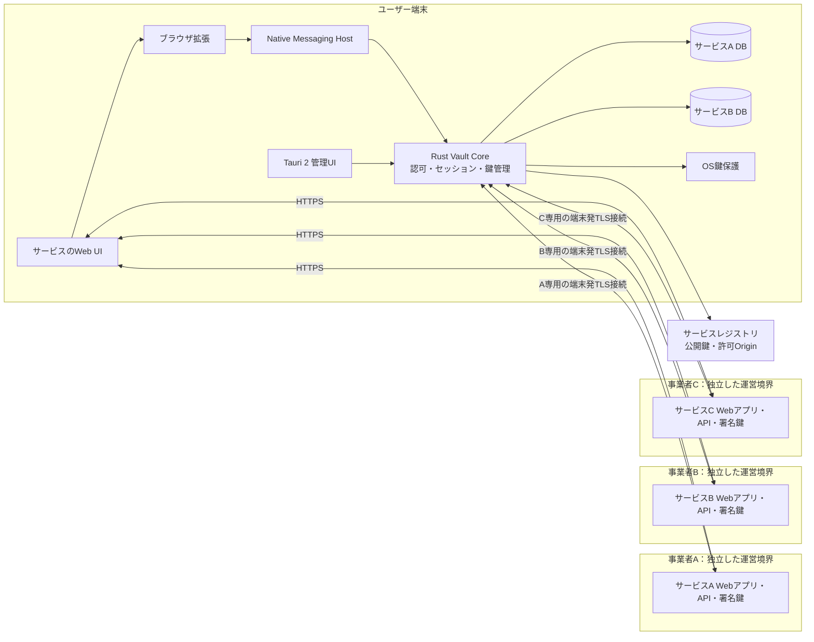
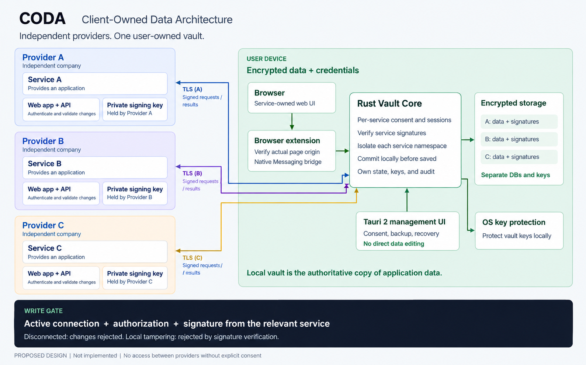
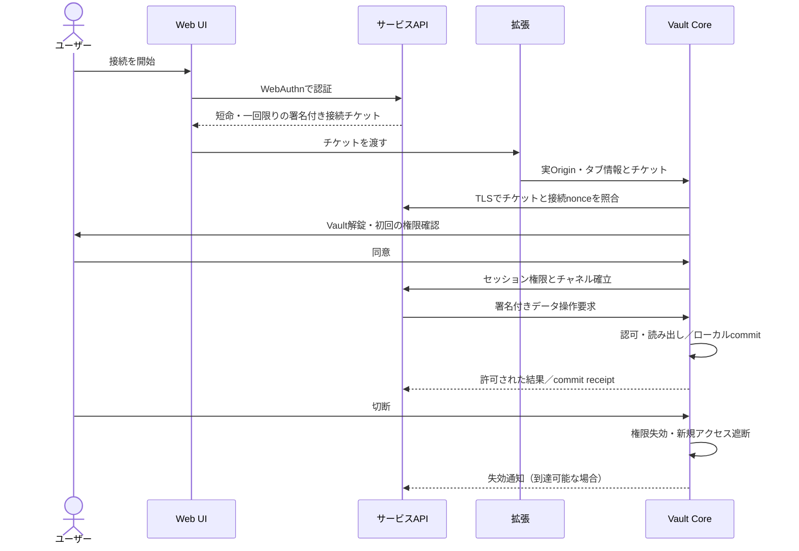
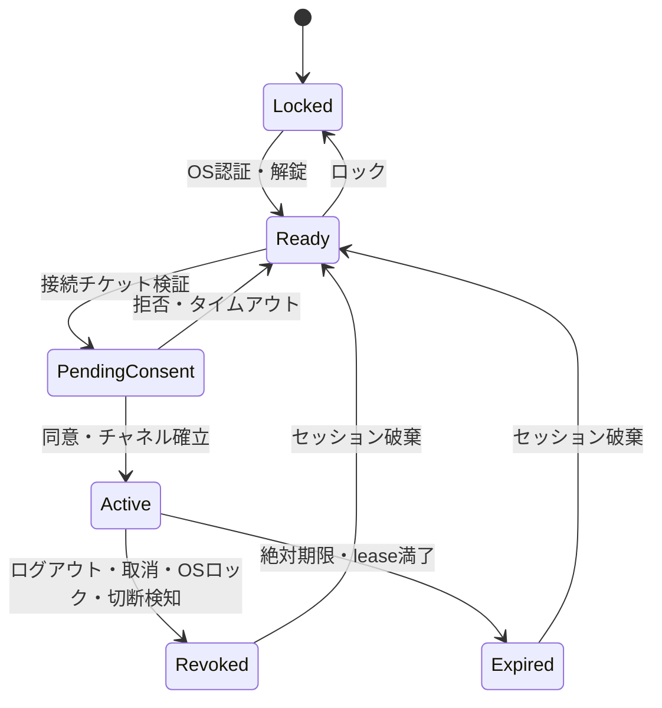

# CODA 認証・ユーザー所有データ基盤 設計仕様書

| 項目 | 内容 |
| --- | --- |
| バージョン | 0.3.0 — 複数の独立事業者によるサービス提供 |
| 作成日 | 2026-10-10（Asia/Tokyo） |
| 実装状況 | 未実装。文書のみ |
| 原案 | [認証システム設計](chatgpt-conversation://6ac9c1c7-b838-83ee-9d5b-0002ad90b077) |
| 対象 | 共通Vault、ブラウザ連携、サービス連携SDK、運用基盤 |

## 1. 目的と要件の出典

**サービスはアプリケーションを提供し、ユーザーは認証情報とデータを所有する。サービスには、ユーザーが許可した時間と範囲に限り、データを利用する権限を与える。**

原会話でユーザーが述べた要件を以下に固定する。会話中のアシスタントの提案は承認済みの決定とは扱わず、本書の設計案として具体化する。

R-08は2026-10-10の本チャットで追加された確定要件である。

R-09は同日の本チャットで明確化された事業者モデルである。

| ID | ユーザー要件 | 本書での実現方針 |
| --- | --- | --- |
| R-01 | ユーザー端末にSQLiteのようなDB、ユーザー情報、データを持たせる | 暗号化したローカルVaultを正本とする |
| R-02 | サービス側は接続時だけ情報を取り寄せ、原則として保存しない | 許可された処理に必要な最小データを一時利用する |
| R-03 | 複数のWebサービスA・B・Cが共通の認証システムを使う | 共通プロトコル、サービス別名前空間、連携SDK |
| R-04 | アプリはサービス側、ユーザー側はデータと認証情報を所有 | 業務アプリはWebサービスに置き、端末は共通基盤だけを導入する |
| R-05 | SSDを使うときだけ接続するような利用感 | Vaultの接続・切断を利用許可に対応させる。外付けSSD対応は後続段階 |
| R-06 | 強いセキュリティを意識せず使える | Passkey、OS鍵保護、最小権限、自動失効、重要操作だけ再確認 |
| R-07 | 認証後、セッション確立中だけデータを利用可能にする | Vaultが毎回認可し、失効後の新規読み出し・更新を拒否する |
| R-08 | サービスに接続しないと、ユーザー側のデータをローカルで改変できない | 業務データの作成・更新・削除・取り込みは、接続中の当該サービスが署名した操作だけをCoreが確定する |
| R-09 | 複数の独立した事業者がサービスを提供する | 事業者A・B・Cがそれぞれ自社Webアプリ、API、認証設定、署名鍵を持ち、共通Vaultに個別接続する |

「ログアウト時にデータを返す」という原案は、電源断でも保存済みデータを失わないよう、変更ごとにローカルへ確定する方式に改善する。ログアウトは保存の唯一の契機にしない。

## 2. 保証範囲と保存ポリシー

### 2.1 保証する性質

- ユーザーデータの正本は端末にあり、DBファイルや復号鍵をサービスへ渡さない。
- サービス認証だけではデータ権限を与えず、ユーザーの同意と有効なVaultセッションを必要とする。
- サービス間のアクセスは初期状態で拒否し、共有は対象・目的・期間を指定した別の同意とする。
- 保存完了はローカルの永続化成功後にのみ表示する。失効・ロック・障害時は拒否を既定にする。
- Vaultの解錠だけでは業務データの書き込み権限を得られない。管理UI、拡張、ローカルSDK、オフライン操作には直接編集経路を設けない。
- サービス署名のない業務データや改変されたデータは、正規データとして受理・サービスへ提供しない。

### 2.2 保証できない性質

サービスへ渡した平文のコピーを、セッション終了後に暗号学的に回収・消去することはできない。「終了後は利用不可」はVaultからの追加取得・更新を遮断する意味であり、受信済みデータの消失を意味しない。事業者による非保存は実装・運用・監査でも担保する。

端末OSの完全侵害、許可済みサービスによる処理中の持ち出し、画面撮影、利用者自身によるコピーは完全には防げない。公開投稿、決済、在庫、他者との取引のような共有状態は、本MVPの対象外とする。

R-08は正規のソフトウェア経路による論理的な改変を禁止する要件である。端末の所有者が管理者権限でファイルのバイトを書き換える、消す、Coreを差し替えることまで物理的に阻止する保証ではない。サービス秘密鍵を端末に置かず、サービス側も署名を検証することで、改変した内容を正規データとして受理することを防ぐ。正しく署名された古いデータへの完全な巻き戻しは別問題であり、最新世代の独立した記録なしには検知を保証しない。

| 分類 | 保存先・期間 | 制約 |
| --- | --- | --- |
| 個人プロフィール、文書、履歴、設定 | ローカルVaultに永続保存 | サービスのDB・ログ・バックアップへ入れない |
| 秘密鍵、DB暗号鍵 | 端末の保護領域／暗号化した鍵包 | ブラウザ、サービス、通常ログへ渡さない |
| サービス登録情報、公開鍵 | レジストリおよびVaultの検証済みキャッシュ | 個人データを含めない |
| Passkey公開鍵・credential ID・サービス別仮名ID | 当該サービスに認証管理情報として永続保存する案 | 個人に関連するメタデータであることを開示。保存ゼロの例外として採否を確定する |
| サービスの処理入力・出力 | セッション内のメモリ | 完了・期限切れ・切断で破棄。永続キューへ入れない |
| Vault監査記録 | 端末内 | 本文・秘密・トークンを含めない |
| サーバー運用メトリクス | 集計値中心、仮設定7日 | IPや仮名IDも個人関連情報として最小化。実運用前に保存項目を確定する |
| 暗号化バックアップ | ユーザーが選んだ別媒体 | サービス事業者に復号鍵を渡さない |

認証管理情報すらサーバーに保持しない方式は、失効・復旧・不正利用対策との整合を別途設計する必要がある。本案は「業務データ非保存」と「最小の認証メタデータ保存」を区別する。これを未決事項D-01として公開前に確定する。

## 3. スコープ

MVPはmacOSとChromium系ブラウザを最初の検証対象とし、共通Vault、ブラウザ拡張、異なる事業者を模したサービスA/Bのデモを実装する。デモでもOrigin、API、認証設定、署名鍵を独立させる。端末に共通ソフトと拡張機能のインストールを必要とする案であり、ブラウザだけの完全ポータブル動作は約束しない。

Windows・Linux・Safari、外付けSSD、複数端末同期、クロスサービス共有、モバイル、TEE・ゼロ知識証明は後続段階とする。MVPでも暗号化バックアップと復旧は必須で、唯一の端末の紛失で全データが失われる状態のまま一般公開しない。

## 4. 全体構成と信頼境界



サービスA・B・Cは別会社が運営する想定であり、各事業者が独自の業務バックエンドと秘密鍵を持つ。共通化するのはVault、接続プロトコル、連携SDK、サービス登録の仕組みである。中央の共通業務APIや事業者間の共有ユーザーDBは必要としない。一つの事業者が複数サービスを提供する場合も、認可とデータ分離の単位はサービスIDのままとする。



| コンポーネント | 責務 | 信頼・権限の境界 |
| --- | --- | --- |
| Web UI | 事業者の業務画面、接続開始、状態表示 | 非信頼入力。Vaultの鍵・DBにはアクセス不可 |
| ブラウザ拡張 | 実際のタブOrigin・フレーム・接続先を検証して橋渡し | ページが申告したOriginを信じない |
| Native Host | 許可された拡張とCore間のIPC | 任意コマンド、SQL、ファイルパスを受け付けない |
| Vault Core | 鍵、同意、状態機械、認可、永続化、監査 | アクセス制御の最終判断者 |
| Tauri UI | 接続一覧、同意、バックアップ、復旧、監査表示 | 業務データの直接編集・作成・削除不可。権限の正本にならない |
| 各事業者のサービスAPI | 自社サービスの本人確認、署名付き要求、許可された計算 | 他事業者の鍵や権限を共有せず、他サービスの名前空間を参照できない |
| レジストリ | 事業者ID、サービスID、Origin、公開鍵、失効情報 | 業務データを仲介しない。登録は安全性の保証や包括的データ許可ではない |

Native Messagingの許可拡張IDだけではWebページのOrigin認可にならない。拡張が送信元タブ・トップフレーム・登録Originを検証し、CoreがセッションのサービスIDと照合する。MVPは第三者iframeからの接続を拒否する。[Chrome Native Messaging](https://developer.chrome.com/docs/extensions/develop/concepts/native-messaging)

端末側からサービスAPIへのTLS接続を開くため、外部から端末への着信ポートは不要とする。Webサイトが呼び出せる汎用localhost HTTP APIは公開しない。

## 5. 実装構造

Rustに`DocumentStore`、`VaultState`、`SessionManager`、`PolicyEngine`、`KeyProvider`、`AuditStore`、`Renderer`の責務を置く。単一のCoreプロセスが状態を所有し、Native HostとTauri各ウインドウは認証済みIPCを通じて操作する。IPCはOSユーザー権限、接続元、メッセージ形式、サイズを検証する。

Tauri 2のWebViewは信頼する同梱UIだけを表示する。外部の業務サイトを特権WebViewに読み込まない。ウインドウごとのcapabilityを最小化し、ファイル操作やシェル実行を包括許可しない。

管理UIは「接続」「データ」「監査」「バックアップ」のパネルをドッキング／フローティングできる設計にする。分離したウインドウにも状態や鍵を複製せず、Coreからの投影を購読させる。ウインドウを閉じても業務状態が失われないようにする。

「データ」パネルは容量、署名検証状態、最終保存時刻などの管理情報を示す。業務データの編集画面は当該サービスの接続中のWeb UIだけが提供する。OS認証済みの管理UIにも`records.mutate`の権限を与えない。

高負荷な画像処理・GPU描画を追加する場合はRust／wgpuに実装する。大容量データはRust/GPU側に保持し、Rust↔JavaScript間は命令、参照ID、必要最小限の状態だけを渡す。MVPの管理画面のためだけにGPU処理を増やさない。

## 6. 認証、サービス識別、同意

### 6.1 別々に検証する三つの条件

1. **ユーザー認証**：各サービスがWebAuthnで本人を確認する。チャレンジ、RP ID、Origin、署名、ユーザー検証結果を検証する。Passkeyをサービス間で共有する設計にはしない。
2. **サービス認証**：Coreが登録済みサービスID、HTTPS Origin、署名鍵、失効状態を検証する。
3. **データ認可**：Coreがローカルのユーザー同意とセッション状態を照合する。サービスがログイン済みと主張しても、この条件を省略しない。

WebAuthn認証とVault解錠は別の機能である。Passkey秘密鍵からDB鍵を直接生成しない。端末の生体認証／OS認証でVault鍵の使用を許可する。[W3C WebAuthn](https://www.w3.org/TR/webauthn-3/)

### 6.2 サービス登録

登録項目は`provider_id`、グローバルに一意な`service_id`、事業者名、サービス名、完全一致の許可Origin、固定API接続先、署名公開鍵と`kid`、鍵有効期間、要求可能なスコープ、対応スキーマ、非保存ポリシー版とする。署名鍵の参照はサービスIDとkidの組で解決し、他事業者の同名kidを受理しない。ワイルドカードOriginはMVPで認めない。

サービス登録時に事業者とOrigin・署名鍵の所有関係を確認する。各サービスのPasskey RP、同意、セッション、復旧承認は独立させ、共通Vaultの利用を事業者間SSOや包括的認可とは扱わない。事業者Aは事業者Bの更新・復旧・権限付与に署名できない。サービス単位の失効はそのサービスに限定し、事業者単位の失効を明示した場合だけ配下の全サービスへ適用する。

MVPでは管理された固定レジストリを使う。未知のサービスの自動登録や、リクエストに指定された任意URLからの公開鍵取得は認めない。鍵変更は既存の信頼経路で承認し、緊急失効した鍵に関連するセッションを終了する。

### 6.3 接続フロー



チケットはサービスID、サービス別仮名ID、Origin、要求スコープ、nonce、発行時刻、有効期限、サービスのセッション公開鍵を署名対象に含める。Core生成nonceとの照合で接続を結び付け、チケットは一度だけ消費する。期限は仮設定60秒。

同意画面は信頼するVault UIに表示し、サービス名・検証済みドメイン・対象データ・読み書き・外部送信・期限を示す。再接続時は同意済み範囲内で自動化できるが、スコープ拡張、他サービス共有、大量取得、エクスポート、復旧には再確認が必要。

## 7. セッション認可プロトコル

### 7.1 権限モデル

MVPのCoreチャネルでは、ランダムな不透明`session_id`をローカル状態に対応させる。単独のIDをBearer権限として受け付けない。チケットに結び付いたサービスのセッション鍵による要求署名を必須とする。

| 状態項目 | 内容 |
| --- | --- |
| `service_id`, `origin`, `subject` | 接続先、実Origin、サービス別仮名ID |
| `namespace`, `collections`, `actions` | 対象領域、コレクション、read/create/update/delete等 |
| `field_allowlist`, `egress_mode` | 返してよいフィールド、ローカル処理／外部送信 |
| `issued_at`, `expires_at`, `lease_deadline` | 絶対期限と生存確認期限 |
| `session_key`, `consent_version`, `epoch` | 送信者鍵、同意版、再起動・失効世代 |
| `max_bytes`, `max_operations` | 単位時間とセッション合計の取得・操作上限 |

要求はプロトコル版、セッションID、単調増加する連番、要求ID、Coreのnonce、操作、対象、本文ダイジェスト、期限を正規化して署名する。正規化形式・署名アルゴリズム・テストベクトルは実装前のプロトコル仕様で固定する。暗号プリミティブは既存ライブラリを利用し、独自暗号を作らない。

Coreは署名、鍵との結び付き、nonce、連番、期限、接続先、スコープ、割当量、現時点の失効状態を要求ごとに検証する。本文署名には全ての操作引数を含め、署名後の対象差し替えを防ぐ。

書き込みは当該サービスのAPIが業務規則を検証して署名した要求に限定する。サービスの書き込み署名秘密鍵はサーバー側に保持し、Web UI、拡張、Vault、利用者の端末に配布しない。サービスは署名要求を無条件に受け付けず、ユーザー認証・権限・入力を検証する。

### 7.2 DPoPとの関係

将来OAuthのHTTP APIを公開する場合はRFC 9449のDPoPを候補とし、公開鍵拘束とproofの`htm`、`htu`、`iat`、`jti`、`ath`、必要なnonceを検証する。DPoP自体はサービス認証やHTTP本文全体の完全性を保証しない。MVPのNative Messaging／双方向チャネルの署名要求を「DPoP準拠」と呼ばない。[RFC 9449](https://www.rfc-editor.org/rfc/rfc9449.html)

### 7.3 状態機械と期限



仮設定は絶対期限15分、heartbeat間隔10秒、lease上限30秒。heartbeatは拡張の有効なタブ接続とCoreの解錠状態に基づき、サービス単独では延長できない。通信断を検知した場合は直ちに停止し、検知できない異常はlease満了で停止する。背景タブ停止は安全側に失効させる。

ログアウト・権限取消はCoreのセッションロック下で失効を確定してから成功を返す。更新commitと失効を直列化し、失効確定後に更新をcommitしない。読み出しは送信直前にも状態を確認する。すでに送信したバイトは取り消せない。

再起動、スリープ復帰、時計の大幅な変更では既存セッションを復活させない。実行中の期限は単調時計で管理し、再接続では新たなnonce・セッション鍵・IDを使う。長命refresh tokenはMVPで発行しない。

`Locked`、`Ready`、`PendingConsent`、`Revoked`、`Expired`では業務データの変更を拒否する。`Active`でも当該サービスの認証済みチャネルが切断されていれば拒否する。切断中の編集キューやオフライン下書き保存はMVPで提供せず、接続中に発行された未確定要求も失効後にはcommitしない。再接続後の再試行には現在のセッションに結び付いた新しい署名要求を必要とする。

## 8. データ保存と更新整合性

### 8.1 ローカル配置

```text
vault/
  manifest.json                  # 形式版・ランダムVault IDのみ
  identity.db                    # 暗号化：同意、登録キャッシュ、鍵包
  services/<opaque-service-id>/
    data.db                      # サービス別SQLCipher DB
    blobs/                       # 独立した認証付き暗号化オブジェクト
  audit.db                       # 暗号化：監査イベント
```

サービス名やユーザー名を平文パスに入れない。データベースはサービスごとに独立したランダム鍵を使う。SQLCipherのページ暗号化・完全性検査を利用し、WAL、ジャーナル、一時領域を含む漏洩検査を実施する。[SQLCipher Design](https://www.zetetic.net/sqlcipher/design/)

### 8.2 論理モデル

| エンティティ | 主なフィールド・制約 |
| --- | --- |
| `ServiceRegistration` | provider_id、service_id、provider_name、origins、signing_keys、status、registry_version |
| `Consent` | consent_id、service_id、scope、policy_version、expires_at、revoked_at |
| `Record` | record_id、collection、schema_version、revision、payload、updated_at、tombstone、service_signature、signing_kid |
| `OperationReceipt` | operation_id、request_hash、result_revision、commit_id。サービス内一意 |
| `SignedMutation` | サービス・利用者・Vault・対象レコード・操作・前後revision・内容ダイジェスト・operation_id・前状態ダイジェスト・署名。削除も署名付きtombstone |
| `Credential` | issuer、subject、claims、expires_at、signature、status_reference |
| `AuditEvent` | event_id、sequence、service_id、action、outcome、previous_hash |
| `Session` | メモリのみ。再起動時に必ず失効 |

サービスが生SQL、任意ファイルパス、任意Rustコードを渡すAPIは設けない。名前空間はCoreが認証済みサービスIDから解決し、リクエストで任意指定できないようにする。

### 8.3 書き込み契約

1. 接続中のサービスAPIが入力と業務規則を検証し、`operation_id`、`expected_revision`、確定後の内容を含む署名付き更新を現在のセッションに結び付けて要求する。
2. Coreは有効な接続・セッション、認可、スキーマ、サービス署名、前状態を検証し、更新・署名証跡・receiptを同じDBトランザクションで確定する。commit直前にも接続と失効状態を検証する。
3. 永続化成功後に`commit_id`、新revision、operation_idを返す。Web UIはこの応答を受けて保存完了を表示する。
4. 応答が失われた場合、再接続後に同じoperation_idで結果を照会する。同じID・同じ内容なら再適用せず同じ結果を返す。異なる内容なら拒否する。
5. revisionが一致しない更新は競合として返し、既存データを自動で上書きしない。

receiptを削除する場合は再送可能期間を定義し、削除済みIDを新規操作として再受理しない仕組みを先に導入する。MVPではreceiptを保持し、容量上限では明示エラーにする。

「保存済み」はストレージが同期要求を正しく実装する前提の保証である。電源断・容量不足・SSD取り外しは受け入れ試験に含める。ブラウザ終了イベントに依存しない。

DB移行は版を確認してバックアップ後にトランザクションで行い、未知の上位版は書き込み禁止とする。Blobは暗号化一時ファイルから永続化後に参照をcommitし、障害時の孤立Blobを回収する。

### 8.4 サービス接続を必須とする更新制御

| 操作 | 未接続時 | 接続中 |
| --- | --- | --- |
| 業務レコードの作成・更新・削除 | 拒否 | 当該サービスの署名と許可scopeがある場合だけ確定 |
| JSON・CSV等の取り込み、編集済みバックアップの投入 | 拒否 | サービス側の検証と署名付き更新を経由する |
| 管理UI・ローカルCLI・拡張からの直接編集 | 拒否 | 同様に拒否。サービスAPIを経由する |
| 同意取消、切断、Vaultロック | 許可 | 許可。業務レコードを書き換えない |
| 暗号化バックアップ作成、復旧候補の検証 | 許可 | 許可。内容編集は認めない |
| 復旧候補の業務データへの昇格 | 拒否 | 当該サービスの再検証・署名付き復旧承認後のみ |
| 鍵包更新・物理格納形式の移行 | 論理内容と署名が不変の場合だけ許可 | 論理内容を変える移行はサービス署名を必要とする |

接続先がサービスAであっても、サービスBのデータを変更する権限は得られない。データ共有・同期・将来のインポートもこの条件を省略しない。内部監査の追記や破損した一時ファイルの回収は業務データの編集とは区別し、署名された論理内容を変更しない。

異なる事業者間の将来の共有では、利用者が提供元・提供先・対象・用途・期間を明示して同意する。提供元の署名を提供先の更新承認として流用せず、提供先への取り込みには提供先サービス自身の検証と署名を必要とする。

### 8.5 永続データの署名と改変検出

保存時の暗号化に加え、サービスが承認した論理状態に公開鍵署名を付ける。短命なセッション要求署名と、後からデータの真正性を検証する永続署名は目的を分ける。永続署名はレジストリの信頼経路で検証可能なサービス鍵で行い、端末のDB鍵やMACだけを真正性の根拠にしない。

署名対象には`service_id`、サービス別subject、Vault ID、record ID、collection、schema_version、revision、内容または内容ダイジェスト、Blobダイジェスト、削除状態、operation_id、前状態ダイジェストを含める。別利用者・別Vault・別サービスへの移植を拒否する。署名付きサービス領域manifestでレコード集合も検証し、単独のレコード削除・追加を検出する。操作、manifest更新、署名証跡、receiptは同一トランザクションで保存する。

署名形式はJWS、JSONの署名前の正規化はJCSを候補とし、許可アルゴリズム、署名対象、検証鍵履歴、鍵失効時の扱いをD-04で固定する。署名なし方式や、入力が指定した公開鍵をそのまま信頼する方式は採用しない。[RFC 7515: JWS](https://www.rfc-editor.org/rfc/rfc7515.html)、[RFC 8785: JCS](https://www.rfc-editor.org/rfc/rfc8785.html)

Coreは開くとき・読み出す前・更新の前に署名とmanifestの整合性を検証する。不一致は`DATA_INTEGRITY_FAILED`として当該サービス領域を隔離し、自動修復・再署名・無署名データへの置換を行わない。サービスAPIも受け取ったデータの永続署名を独立して検証し、改変Coreによる検証省略を信用しない。

署名は全ての正規スナップショットの新旧を判定できるものではない。古い正規データ一式への巻き戻しを防ぐには独立した最新チェックポイントが必要になる。サーバーに最小のrevision／manifestダイジェストを保持するか、ユーザー管理の独立媒体を使うかはD-08で決定する。どちらもない場合、鮮度保証を要する処理と復旧候補の昇格は保留する。

## 9. 鍵管理、バックアップ、復旧

- DB鍵はCSPRNGで生成し、サービスごとに独立させる。Passkey、サービス署名鍵、DB鍵、バックアップ鍵を使い回さない。
- OSの鍵保護機構で鍵包を保護する。Secure Enclave／TPMの利用可否は機種ごとに検証し、全端末で利用可能とは扱わない。
- 解錠中の平文鍵とDB接続はCore内に限定する。ロック時に接続を閉じ、可能な範囲で鍵メモリを消去する。OS侵害に対する完全なメモリ保護は保証しない。
- 新端末への移行は、既存端末による承認または利用者が保管した復旧秘密で鍵包を再保護する。暗号化SSDを挿しただけでは解錠できない。
- バックアップは整合したスナップショットと暗号化Blob、暗号化manifest、復旧用鍵包を一組にする。稼働中DBファイルの単純コピーは使わない。
- 復旧秘密はサービスへ送信しない。復旧秘密と全ての承認済み端末を失った場合は復号不能であることをセットアップ時に説明する。
- 復旧は一時領域で形式・完全性・サービス署名を確認し、復旧候補として隔離する。未接続時に業務データへ切り替えない。当該サービスへの接続後、再認証、署名・最新世代の照合、サービスの署名付き復旧承認を得て切り替える。複数サービスのバックアップはサービス単位で承認する。最新世代を独立して照合できない場合は巻き戻り検証不可と表示し、昇格を保留する。
- 鍵更新はクラッシュで旧・新のどちらも開けなくなることがないよう、鍵包の版と切替を原子的に管理する。鍵流出後の更新で既に複製された過去データを回収することはできない。

多端末同期はMVPで実装しない。同一Vaultの同時書き込みも禁止する。後続段階では端末登録・失効、暗号化転送、競合解決、削除伝播、巻き戻り検知を先に仕様化する。

## 10. 連携インターフェース案

以下はCoreの論理メッセージであり、localhost上の公開HTTPエンドポイントではない。外部SDKに鍵や内部パスを返さない。

| メソッド | 入力 | 成功時 | 主要な条件 |
| --- | --- | --- | --- |
| `vault.status` | プロトコル版 | locked / ready | 個人情報や他サービス一覧は返さない |
| `session.open` | 接続チケット、信頼できる拡張コンテキスト | session_id、期限、許可scope | 登録・認証・同意が成立 |
| `records.read` | collection、record_id、fields | 許可フィールドとrevision | read権限・取得量制限 |
| `records.query` | 定義済みfilter、cursor、limit | 有界ページ | 任意SQL不可、最大100件（仮） |
| `records.mutate` | operation_id、expected_revision、署名付き操作・manifest | commit receipt | 接続中の当該サービスAPI限定。失効とcommitの直列化 |
| `operations.status` | operation_id | 既存receiptまたはunknown | 同一サービス・許可範囲のみ |
| `session.close` | session_id | revoked | 繰り返し呼べる |
| `consent.revoke` | consent_id | 失効結果 | 信頼する管理UI限定 |
| `backup.create/restore` | 管理UIからの限定参照 | 進捗・隔離された復旧候補 | 再認証。直接の業務データ切替不可 |
| `backup.activate` | 復旧候補ID、サービスの署名付き復旧承認 | サービス領域の切替結果 | 接続中の当該サービス、署名・最新世代照合・ユーザー確認が必要 |

初期のメッセージ上限は256 KiBとし、大容量ファイルは後続の専用ストリームで扱う。Native Messagingに大きな画像やフレームを流さない。

エラーは`{code, retryable, request_id}`を基本とし、`VAULT_LOCKED`、`CONSENT_REQUIRED`、`SERVICE_CONNECTION_REQUIRED`、`SERVICE_SIGNATURE_REQUIRED`、`DATA_INTEGRITY_FAILED`、`RESTORE_APPROVAL_REQUIRED`、`SESSION_EXPIRED`、`SESSION_REVOKED`、`SCOPE_DENIED`、`REPLAY_DETECTED`、`REVISION_CONFLICT`、`STORAGE_UNAVAILABLE`、`UNSUPPORTED_VERSION`を定義する。DBパスや他サービスの存在をエラーに含めない。ユーザー向け文言は別途翻訳する。

## 11. サービス側の処理と非保存

入力、計算結果、例外オブジェクトをDB、NFS、通常ファイル、APM、トレース、アクセスログ、バックアップ、永続ジョブキューへ書かない。HTTP本文と認証ヘッダーのログ記録を禁止する。クラッシュダンプ・swap・プロキシの一時バッファ・キャッシュも検査対象とする。

メモリ上の処理領域にはsession_idと期限を結び付け、処理完了または失効で破棄する。端末のcommit receiptを得られない結果は保存済みと扱わない。サービスのクラッシュで未保存の計算結果が失われることは許容するが、端末で確定済みのデータを失わない。

MVPでは再計算可能な文書・設定の操作を対象とし、決済等の外部副作用は扱わない。ジョブがセッション期限を超える場合は中止し、再認可なしに再開しない。

署名付き会員資格はissuer、subject、audience、期限、署名、失効状態を検証する。ローカルの`premium=true`を信用しない。署名だけでは二重使用や残高の巻き戻しを防げないため、課金・回数制限には別途信頼できる共有状態が必要となる。

## 12. 脅威と対策

| 脅威 | 必須対策 | 残る限界 |
| --- | --- | --- |
| 悪意あるサービスの越権 | 名前空間・フィールド・操作の許可リスト、取得量制限 | 許可して渡した情報のコピー |
| トークン／要求の再利用 | セッション鍵拘束、nonce、連番、期限、失効状態 | 有効鍵を制御する攻撃者 |
| XSS・偽装ページ | 実Origin検証、信頼する同意UI、最小権限 | 正規Origin内の攻撃は許可済み操作を悪用し得る |
| IPC／拡張の悪用 | 拡張ID制限、OSユーザー境界、入力検証、fuzzing | 拡張やCoreそのものの侵害 |
| SSD・端末の盗難 | DB暗号化、OS鍵保護、復旧秘密の別保管 | 解錠中端末の侵害 |
| ローカル直接編集・DBやBlobの差し替え | 接続必須、サーバー側の署名鍵、永続署名・manifest、Coreとサービスの独立検証 | ファイル破壊は防げない。正規スナップショット全体の巻き戻しは別対策が必要 |
| 古いデータへの巻き戻し | revision、署名資格の期限・失効、世代比較 | 信頼できる最新記録が全て失われた状態 |
| 更新競合・異常終了 | CAS、原子的commit、冪等receipt、復旧試験 | 未保存編集・未返却計算結果 |
| ログ経由の漏洩 | payload非記録、canary検査、例外の無害化 | 悪意ある運用者による記録 |
| 供給網・更新攻撃 | 署名付き配布、依存固定、脆弱性確認、更新経路監査 | 署名・ビルド基盤の侵害 |

監査ログは前イベントのハッシュを含めて連結し、削除・変更の検知を補助する。ただし、独立したチェックポイントがない完全な巻き戻しは検出できない。外部チェックポイントの利用はメタデータ送信を伴うため、後続の任意機能とする。

## 13. UXと多言語対応

対応ロケールは`ja`、`en`、`zh-Hans`。初回はOS言語を使い、設定で切替可能にする。未知のロケールは英語へフォールバックする。同意内容、復旧案内、エラーを全言語で同じ意味に保ち、翻訳欠落をCIで検出する。

| キー | 日本語 | English | 简体中文 |
| --- | --- | --- | --- |
| `vault.unlock` | データ保管庫を開く | Unlock vault | 解锁数据保险库 |
| `session.connect` | サービスに接続 | Connect to service | 连接服务 |
| `consent.read_write` | 選択したデータの読み取りと更新を許可します | Allow reading and updating the selected data | 允许读取和更新所选数据 |
| `session.disconnect` | 接続を終了 | Disconnect | 断开连接 |
| `save.confirmed` | 端末に保存しました | Saved to your device | 已保存到你的设备 |
| `save.pending` | まだ保存されていません | Not saved yet | 尚未保存 |
| `session.expired` | 接続の有効期限が切れました | Your session has expired | 会话已过期 |
| `data.connection_required` | データを変更するにはサービスに接続してください | Connect to the service to change your data | 请连接服务以修改数据 |
| `data.integrity_failed` | データの整合性を確認できません。復旧が必要です | Data integrity could not be verified. Recovery is required. | 无法验证数据完整性，需要恢复 |
| `recovery.approval_required` | 復旧を完了するにはサービスへの接続と承認が必要です | Connect to the service and obtain approval to complete recovery | 完成恢复需要连接服务并获得批准 |
| `recovery.warning` | 復旧キーを失うと、データを復元できない場合があります | If you lose your recovery key, you may be unable to restore your data | 如果丢失恢复密钥，你可能无法恢复数据 |

常時表示は接続サービス、アクセス対象、保存状態、切断ボタンを中心とする。日常操作のたびに確認を増やさず、既存同意の範囲内だけ自動化する。接続終了とデータ削除を別の操作として示す。

切断・期限切れ時にはWeb UIの業務編集操作を無効にし、接続案内を表示する。画面側の無効化に加え、CoreとサービスAPIでも拒否する。業務データの削除は接続中の署名付き操作とし、同意取消や接続解除はオフラインでも行える。端末からのVaultファイルの物理削除まで防ぐという意味ではない。

見出しは意味のまとまりで折り返し、固定の改行を全言語へ流用しない。狭いウインドウ、200%表示、キーボード操作、スクリーンリーダー、長い英語文言で実画面を確認する。

将来SwiftUI版を作る場合は全コンテンツをSafe Area内に収め、左右16pt以上を確保する。`.frame(maxWidth: .infinity)`には`.padding(.horizontal)`を併用し、`.ignoresSafeArea`は背景・フルスクリーン要素に限定する。PreviewProviderにはiPhone SE（第3世代）とiPhone 16 Pro Maxの両方を含める。

## 14. 本番インフラ案

MVPのローカル検証ではクラウドを必須にしない。サービスレジストリや複数の連携サービスを本番運用する段階では、XServer VPS CloudのApp VPS・Managed PostgreSQL・NFSを中核構成の候補とする。提供状況、接続制約、可用性、バックアップ、リージョンは契約前に検証する。本書は利用可能性を確認した結果ではない。

この候補構成は共通基盤の運営者または採用する個別事業者の配置例である。各事業者は独立したインフラを選択でき、全サービスを同じVPS・DB・ネットワークへ集約することを要求しない。Vaultは登録された各事業者のAPIへ直接接続し、共通レジストリを業務データの中継サーバーにしない。

Managed PostgreSQLは公開鍵・登録情報等の制御情報用であり、Vault内の個人データの保存先にしない。NFSは配布物等の共有用に限定し、稼働中のVault SQLiteや一時平文を置かない。必要になるまでNFSを必須依存にしない。

独立したAI・バッチ・クローラーは通常VPSのWorkerへ分離する。WorkerはCloud側のHTTPS APIまたはジョブキューで通信し、Managed DBへ直接アクセスする構成に依存しない。キューにはジョブID、期限、限定権限等だけを格納し、ユーザーデータを永続保存しない。Worker追加時は新たなデータ受領者として同意と脅威評価を更新する。

## 15. 受け入れ条件

以下は未実施の試験仕様。実装後に結果と環境を記録する。

| ID | 試験 | 合格条件 |
| --- | --- | --- |
| T-01 | A/Bそれぞれのデータ保存 | 両サービスが独立して読み書きでき、相互参照は拒否 |
| T-02 | Origin、鍵、本文、scopeの差し替え | 全て拒否、情報を返さずDB変更なし |
| T-03 | 署名要求の再送・並行再送 | 二重適用なし。異なる本文の同一IDは拒否 |
| T-04 | 読み書きとログアウトの競合 | 失効確定後に新たな送信・commitを開始しない |
| T-05 | 通信断、タブ終了、Core再起動、OSロック | 切断検知で停止。検知不能時もlease上限30秒以内に失効し再起動で復活しない |
| T-06 | commit直前・直後のプロセス強制終了 | 成功応答済み変更を復元でき、再送で二重適用しない |
| T-07 | 容量不足・読取専用媒体・DB破損 | 保存成功を表示せず、既存データを無断初期化しない |
| T-08 | 既知のcanary文字列を処理 | サーバーDB・ログ・トレース・一時ディスク・キュー・バックアップに残らない |
| T-09 | 別端末でのバックアップ復旧 | 正しい復旧秘密で復元。誤った秘密・改変バックアップは拒否 |
| T-10 | 日本語・英語・简体中文の画面 | キー欠落・意味不一致・切れ・不自然な改行なし |
| T-11 | Native Host／IPCの異常入力 | サイズ制限、パス操作、未知メソッド、壊れたJSONで越権・クラッシュなし |
| T-12 | 実機の電源断、SSD取り外し、OS鍵保護 | 対応機種ごとに復旧とロックの動作確認。未検証機種は対応済み扱いしない |
| T-13 | 解錠済み・未接続時にUI、CLI、IPCから作成・更新・削除・取り込み | 全て拒否し、業務データと署名済みmanifestが不変 |
| T-14 | 接続中のローカル直接要求、無署名・偽署名更新、A接続でB更新 | 全て拒否。当該サービスAPIの正規署名付き要求だけ確定 |
| T-15 | レコード、Blob、削除状態、manifestの改変・他利用者データの移植 | Coreとサービスが不正データを拒否し、隔離後に自動再署名しない |
| T-16 | オフライン復旧・編集済みバックアップ・古い正規スナップショット | 復旧候補は隔離。接続・署名付き承認・最新世代照合まで昇格しない |
| T-17 | DB移行、鍵更新、監査追記をオフラインで行う | 業務内容と永続署名が不変。論理変更を伴う移行は接続まで保留 |
| T-18 | 異なる事業者のOrigin・鍵・同名kid・復旧承認を入れ替える | 他事業者の署名や承認でアクセス・更新・復旧できない |
| T-19 | A/Bの同時接続中にAを切断・同意取消・サービス失効する | Aだけ停止しBの有効なセッションは継続。事業者全体の明示失効は対象事業者のサービス群だけに適用 |

性能は目標値として、1 KiBレコードのCore内読み書きp95 100ms以内、1万レコードの試験データを初期基準にする。認証UIとネットワーク時間は別計測し、実測前に達成済みとは記載しない。

## 16. 未決事項と次の設計判断

| ID | 論点 | 現在の仮定／決定期限 |
| --- | --- | --- |
| D-01 | 最小認証メタデータのサーバー保存を許容するか | 本案では許容する案。認証API確定前に決定 |
| D-02 | 共通アプリ・拡張の導入を必須にできるか | MVPでは必須。配布方式確定前に決定 |
| D-03 | OS・ブラウザの最初の正式対応範囲 | macOS＋Chromiumを検証起点とする。実機結果で正式化 |
| D-04 | 要求署名の形式・鍵方式・レジストリ信頼起点 | プロトコル実装前にテストベクトルと併せて固定 |
| D-05 | 復旧秘密の形式と紛失対策 | 一般公開前に復旧UXと独立端末で検証 |
| D-06 | 公開情報・取引記録を持つサービスへの拡張 | MVP対象外。非保存要件の例外を明文化してから追加 |
| D-07 | オープンソース範囲・ライセンス・外部監査 | 公開前に決定。原会話の推奨を未決のまま採用済み扱いしない |
| D-08 | 最新状態チェックポイントと復旧時の鮮度照合 | D-01と併せて実装前に決定。本文を保存せずrevision／manifestダイジェストを保持する案とユーザー管理媒体を比較。未決・照合不能時は復旧昇格を保留 |

## 17. 参考資料

原会話は要件の出典であり、技術標準の根拠とは区別する。以下は2026-10-10に参照した一次資料。具体的なライブラリ版と規格の採用版は実装時に固定する。

- [認証システム設計 — 原会話](chatgpt-conversation://6ac9c1c7-b838-83ee-9d5b-0002ad90b077)
- [W3C WebAuthn](https://www.w3.org/TR/webauthn-3/) — RPに紐づく公開鍵認証。
- [RFC 9449: DPoP](https://www.rfc-editor.org/rfc/rfc9449.html) — OAuthトークンの送信者拘束。MVPの独自チャネルとは区別。
- [Chrome Native Messaging](https://developer.chrome.com/docs/extensions/develop/concepts/native-messaging) — 拡張とネイティブホストの通信境界。
- [SQLCipher Design](https://www.zetetic.net/sqlcipher/design/) — 保存データの暗号化設計。
- [RFC 7515: JWS](https://www.rfc-editor.org/rfc/rfc7515.html) — 永続データの署名形式候補。
- [RFC 8785: JCS](https://www.rfc-editor.org/rfc/rfc8785.html) — JSONの正規化方式候補。
